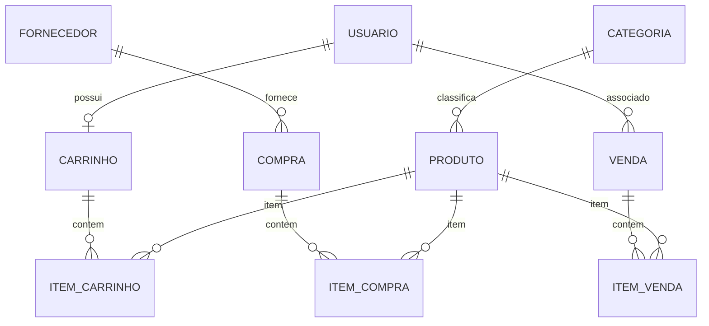

<div class="studio-doc-eyebrow"><span class="studio-doc-eyebrow__mark" aria-hidden="true"></span> 04 / PERSISTÊNCIA <span class="studio-doc-eyebrow__suffix">/ SUPERMARKET MANAGEMENT API</span></div>

# Persistência e banco de dados

O esquema é versionado por Flyway em `src/main/resources/db/migration/`. O modelo descrito abaixo segue o backend em evolução.

> Esta documentação descreve o projeto em evolução. Funcionalidades planejadas não devem ser confundidas com comportamento implementado; o código e os testes prevalecem em caso de divergência.

## 🗄️ Persistência e banco de dados

A aplicação utiliza PostgreSQL 17 como banco de dados relacional.

A persistência é implementada com Spring Data JPA e Hibernate.

### Principais entidades

O modelo atual contempla:

```text
Usuario
Categoria
Produto
Fornecedor
Carrinho
ItemCarrinho
Compra
ItemCompra
Venda
ItemVenda
```

As entidades são relacionadas de acordo com as regras de cada operação.

#### Relacionamentos principais

```text
Categoria
    │
    └── Produto

Fornecedor
    │
    └── Compra
          │
          └── ItemCompra
                │
                └── Produto

Usuario
    │
    ├── Carrinho
    │     │
    │     └── ItemCarrinho
    │           │
    │           └── Produto
    │
    └── Venda
          │
          └── ItemVenda
                │
                └── Produto
```

Esse é o modelo atual. As relações entre funcionários, clientes e vendas serão revisadas nas próximas etapas.

### Flyway

O Flyway é utilizado para versionar alterações no esquema do banco de dados.

As migrations existentes são:

```text
db/migration/
├── V1__criacao_inicial.sql
└── V2__renomear_cliente_para_usuario_e_adicionar_autenticacao.sql
```

A migration V1 introduz a estrutura inicial de persistência.

A migration V2 adapta o modelo de clientes para usuários e adiciona os campos relacionados à autenticação.

As migrations são executadas automaticamente durante a inicialização da aplicação.

### Validação do esquema

O projeto utiliza:

```properties
spring.jpa.hibernate.ddl-auto=validate
```

Dessa maneira, o Hibernate verifica a compatibilidade entre o mapeamento das entidades e o esquema existente.

Mudanças estruturais devem ser realizadas por novas migrations do Flyway.

---


## Relações principais verificadas nas migrations



A migration `V1` cria as tabelas iniciais; a `V2` renomeia `cliente` para `usuario` e inclui credenciais e papel de acesso. Esse modelo ainda será evoluído para as operações presenciais planejadas.
