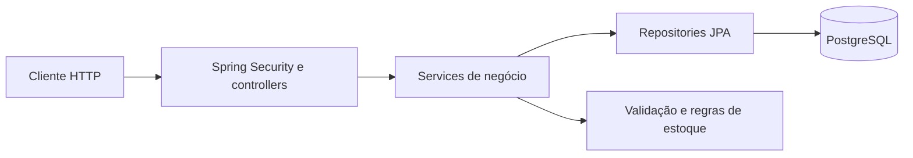

# Supermarket Management API

Bem-vindo à documentação técnica do backend de gerenciamento de supermercado.

O projeto usa **Java 21, Spring Boot 4, PostgreSQL** e está organizado como um **monólito modular**. Este portal reúne arquitetura, regras de negócio, contratos, execução, testes e decisões técnicas em um lugar só.

## Por onde começar

| Você quer... | Acesse |
| --- | --- |
| Entender objetivo e funcionalidades | [Visão geral](visao-geral.md) |
| Conhecer módulos e responsabilidades | [Arquitetura](arquitetura.md) |
| Ver rotas e anotações de autorização | [Mapa de rotas](rotas.md) |
| Executar a API no seu computador | [Execução local](execucao.md) |
| Entender o banco e as migrations | [Banco de dados](banco-de-dados.md) |
| Saber o que falta implementar | [Roadmap](roadmap.md) |

## Estado e escopo

**Este portal documenta um backend em desenvolvimento**, não um produto pronto para operar um supermercado real. Alguns fluxos estão implementados com um modelo transitório de usuário/carrinho e há riscos pendentes em autorização e concorrência de estoque.

O Swagger/OpenAPI gerado pela aplicação, quando em execução, deve ser usado para conferir parâmetros e esquemas atuais dos endpoints. A documentação aqui explica a intenção, os módulos e as decisões, mas não substitui testes.

## Fluxo de alto nível

[Repositório no GitHub](https://github.com/kelwin-feitosa/supermarket-management-api) · [Swagger local](http://localhost:8080/swagger-ui.html)
